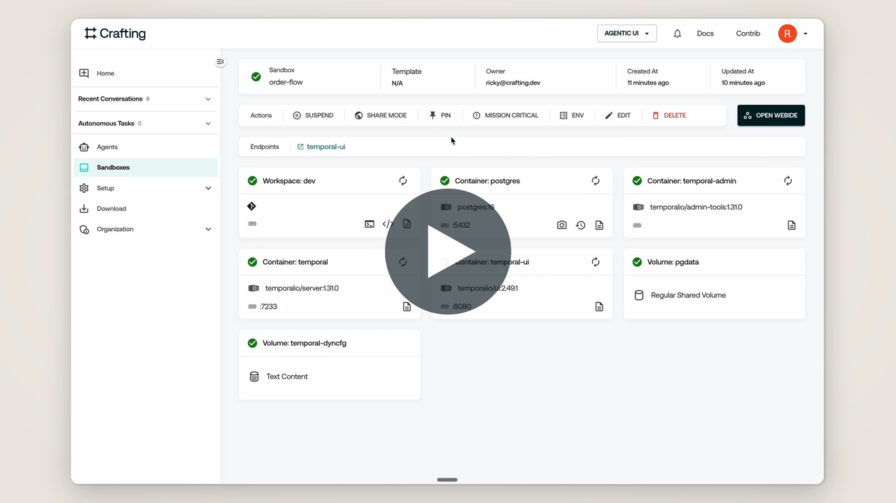

# Temporal Workflow Builder for Crafting

A pair of Crafting agents that turn a process into a working
[Temporal](https://temporal.io) workflow. You can start from an idea described in plain
language, or from a script that already runs in a Crafting sandbox. The builder
interviews you, creates a sandbox with Temporal running, writes and tests the workflow,
and publishes the result as a reusable template.

| Agent | Role |
| :-- | :-- |
| `temporal-builder` | Runs the interview, writes the workflow spec, creates the sandbox, builds and verifies the code, and publishes the template. |
| `temporal-researcher` | Sub-agent. Inspects an existing sandbox read-only and reports how its process works. |

## Demo video

[](https://cdn.jsdelivr.net/gh/crafting-demo/temporal-builder-agent@main/docs/demo.mp4)

## What you get

Every generated sandbox includes:

- **`postgres`**: Postgres 16 storing Temporal's data on a persistent volume, so workflow
  history survives suspend and resume.
- **`temporal-admin`**: creates and upgrades the Temporal schema, then registers the
  `default` namespace.
- **`temporal`**: the Temporal server, reachable inside the sandbox at `temporal:7233`.
- **`temporal-ui`**: the Temporal Web UI, published through the `temporal-ui` endpoint
  (protected by Crafting login).
- **`dev`**: a workspace with:
  - the `temporal` CLI;
  - Temporal's official
    [developer skill](https://github.com/temporalio/skill-temporal-developer) for the
    agent to use;
  - the workflow project in `~/workflow`, whose worker runs as a background daemon.

The workflow project follows a fixed layout, so any template built with it starts
cleanly:

| Path | Purpose |
| :-- | :-- |
| `~/workflow/WORKFLOW_SPEC.md` | The spec you approved during the interview |
| `~/workflow/bin/setup` | Installs the toolchain and dependencies; runs when a sandbox is created |
| `~/workflow/bin/start-worker` | Runs the worker; started by the `worker` daemon |
| `~/workflow/bin/start-workflow` | Starts a workflow execution |

The workspace provides `TEMPORAL_ADDRESS`, `TEMPORAL_NAMESPACE`, and
`TEMPORAL_TASK_QUEUE` as environment variables. Python, TypeScript, and Go are supported.

## Requirements

A Crafting org with LLM agents enabled.

## Install

Enter the following prompt in a **new session** in Crafting's Agent UI with the
**default agent**:

```
Install the Temporal Workflow Builder from https://github.com/crafting-demo/temporal-builder-agent and follow INSTALL.md.
```

The default agent creates a sandbox from this repository and runs `install.sh`, which
installs `temporal-builder` and `temporal-researcher`. They are installed as org-shared
agents if you are allowed to manage shared agents, and as personal agents otherwise.
Paste the same prompt again later to update them.

## Use

In Crafting's Agent UI, start a **new session**, select `temporal-builder`, and describe
what you want. For example:

- From an idea: `I want a workflow that pulls new invoices from an API every hour and emails a summary.`
- From an existing sandbox: `Convert the nightly sync script in sandbox my-app (workspace dev) into a Temporal workflow.`

Reply `ok` to accept a proposed default, or `use defaults for the rest` to skip ahead
to the spec.

The builder then:

1. **Interviews you** about the steps, retries, timeouts, idempotency, signals, deadlines,
   compensation, secrets, and SDK language, proposing a default for each question.
2. **Writes a spec** and waits for your approval.
3. **Creates the sandbox** from the Temporal stack, plus the workloads of your original
   sandbox if you started from one.
4. **Builds and verifies:** in the sandbox's workspace, it writes the workflow, activities,
   worker, and tests, then runs every path in the spec's test plan against the real
   server.
5. **Publishes a template** with `temporal-export-template`. The template includes the
   code, and `cs sandbox create NAME -t TEMPLATE` gives a ready-to-run copy.

## Example: order fulfillment

This workflow charges a mock payment service that fails about half the time, waits up
to 48 hours for a human `ship` signal, reserves inventory, and refunds the payment if
the deadline passes or a later step fails.


See [examples/order-fulfillment.md](examples/order-fulfillment.md) for the opening
prompt (as prose or as this diagram), answers to the interview, and the test runs to
expect.

## Repository layout

| Path | Contents |
| :-- | :-- |
| `INSTALL.md` | Install steps followed by the default agent |
| `install.sh` | Renders the builder definition and creates or updates both agents |
| `agents/temporal-builder.base.yaml` | Builder agent settings (tools, sub-agents) |
| `agents/temporal-builder.md` | Builder instructions; `install.sh` embeds the stack at `{{TEMPORAL_STACK}}` |
| `agents/temporal-researcher.yaml` | Researcher sub-agent |
| `templates/temporal-stack.yaml` | The base sandbox definition |
| `examples/` | Example prompts, answers, and diagrams |

You can also use `templates/temporal-stack.yaml` on its own as a Temporal playground:

```bash
cs template create temporal-stack templates/temporal-stack.yaml
cs sandbox create my-temporal -t temporal-stack
```

## License

Apache License 2.0. See [LICENSE](LICENSE).
