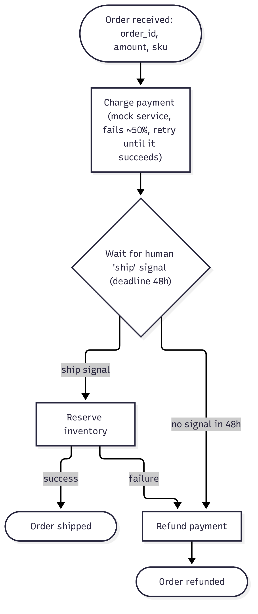
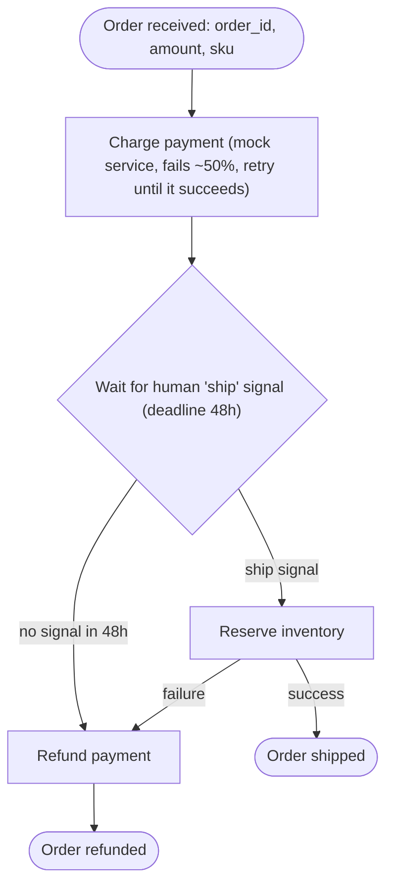

# Example: order fulfillment

A self-contained workflow that needs no external credentials. It shows retries,
a long human wait with a deadline, and compensation.

## Opening prompt

```
I want an order-fulfillment workflow: charge a mock payment service that fails about
50% of the time (so retries show up in the Temporal UI), then wait for a human "ship"
signal before reserving inventory. If nobody ships within 48 hours, or any later step
fails, refund the payment. Start from scratch, there's no existing sandbox.
```

## Opening prompt as a diagram

The same workflow as a Mermaid diagram. It can be pasted as the first message instead
of the prose prompt.



````
Build this workflow from scratch (no existing sandbox):


````

## Answers to the interview

Answer with these (or accept the agent's defaults where they match):

- **Trigger and input:** started on demand with
  `{"order_id": "...", "amount_cents": 4999, "sku": "WIDGET-1", "quantity": 1}`.
  The workflow ID is `order-<order_id>`.
- **Charge payment:** an activity calling a simulated payment service that raises a
  transient error 50% of the time. Retry every 1s, backoff 2.0, max interval 10s,
  up to 10 attempts. A declined card (amount over 100000 cents) is non-retryable.
  The idempotency key is the order ID.
- **Wait for shipping:** a `ship` signal (no payload) from a human. The deadline is
  48 hours, overridable with `ship_deadline_seconds` in the input for tests.
  An `order_status` query returns the current state.
- **Reserve inventory:** a simulated activity. SKUs starting with `OOS-` fail as out
  of stock (non-retryable). Retry transient errors 3 times.
- **Compensation:** if the deadline passes or inventory reservation fails, run a
  refund activity (simulated, retried until it succeeds), and end the workflow with
  status `refunded`.
- **Output:** `{"order_id": ..., "status": "shipped" | "refunded", "charge_id": ...}`.
- **Language:** Python.

## What a successful run produces

- A sandbox with Postgres, the Temporal server, the Temporal UI, and a `dev`
  workspace whose `worker` daemon runs the order worker.
- Test executions covering:
  - the happy path: the `ship` signal is sent and the order is shipped;
  - the deadline path: the deadline is shortened to about a minute and the order is
    refunded;
  - the out-of-stock path: the `OOS-` SKU fails and the order is refunded.
  - In every path, the payment activity shows multiple attempts in its history.
- A template that recreates the whole setup with the worker started automatically.

Example commands in the workspace:

```bash
cd ~/workflow
bin/start-workflow '{"order_id": "1001", "amount_cents": 4999, "sku": "WIDGET-1", "quantity": 1}'
temporal workflow query -w order-1001 --type order_status
temporal workflow signal -w order-1001 --name ship
temporal workflow show -w order-1001
```
